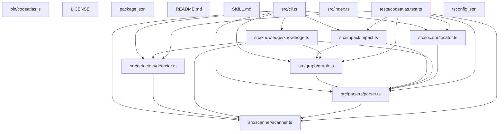

# Architecture Map

Generated by CodeAtlas.

## Technology Stack
- **Languages:** JavaScript, TypeScript
- **Frameworks:** None detected
- **Entry Points:** src/index.ts

## Dependency Flow (Mermaid)

